# DocuMind : Assistant IA de questions-réponses sur documents (RAG)

DocuMind est une application web full stack où une organisation dépose ses documents PDF dans des **espaces** (RH, IT, Management de projets...) et où ses membres posent des questions en langage naturel. Un LLM répond **uniquement à partir des documents** de l'espace et **cite ses sources** (nom du fichier et numéro de page). Les citations sont cliquables et ouvrent le PDF à la page citée.

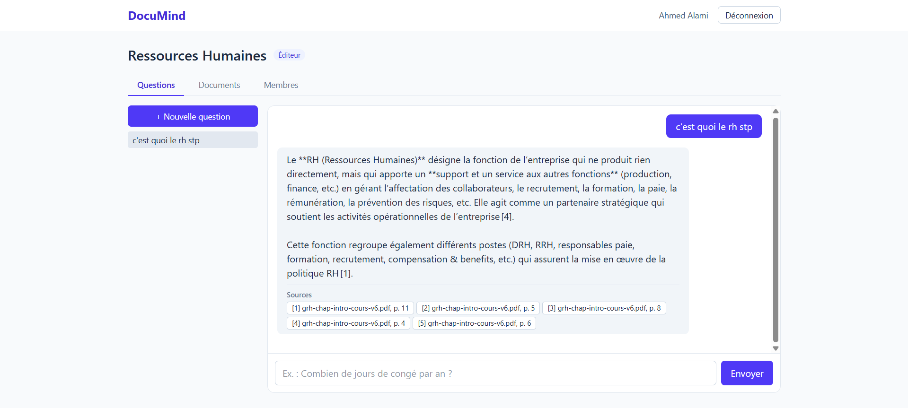

**Sommaire** : [Fonctionnalités](#fonctionnalités) · [Démo](#démo) · [Guide d'utilisation](#guide-dutilisation) · [Architecture](#architecture) · [Stack technique](#stack-technique) · [Installation](#installation) · [Tests](#tests) · [API REST](#api-rest) · [Sécurité](#sécurité-et-données) · [Licence](#licence)

---

## Fonctionnalités

- **Authentification JWT** : inscription, connexion, access token (30 min) + refresh token (7 jours), mots de passe hachés avec bcrypt
- **Espaces de travail avec 3 rôles** (un rôle différent possible dans chaque espace) :

  | Rôle | Poser des questions | Voir les documents | Ajouter / supprimer des documents | Gérer les membres |
  |---|:-:|:-:|:-:|:-:|
  | Administrateur | ✅ | ✅ | ✅ | ✅ |
  | Éditeur | ✅ | ✅ | ✅ | ❌ |
  | Lecteur | ✅ | ✅ | ❌ | ❌ |

  Un non-membre ne peut ni voir l'espace, ni ses documents, ni obtenir une réponse basée sur ses documents.
- **Indexation des PDF en arrière-plan** : extraction du texte page par page, découpage, embeddings multilingues, stockage dans PostgreSQL/pgvector, avec statut en direct
- **Recherche sémantique** avec pgvector, **filtrée par espace**
- **Réponses en streaming** : la réponse s'affiche mot par mot pendant que le LLM l'écrit
- **Citations cliquables** qui ouvrent le PDF à la page citée
- **Historique des conversations** par utilisateur et par espace
- **Tests automatisés** (pytest) et **CI GitHub Actions**

---

## Démo

Le scénario de démonstration utilise une petite organisation fictive avec 4 utilisateurs et 3 espaces (comptes de test, adresses email masquées sur les captures) :

| Utilisateur | Ressources Humaines | Management de projets | Team IT |
|---|---|---|---|
| Imane Touzani | Administrateur | | |
| Ahmed Alami | Éditeur | Administrateur | |
| Ali Arabi | Lecteur | | |
| Siham El Ghazi | Lecteur | | Administrateur |

### 1. Connexion et inscription

Chaque utilisateur crée son compte puis se connecte. Toutes les pages de l'application sont protégées par JWT.

| Connexion | Inscription |
|---|---|
| 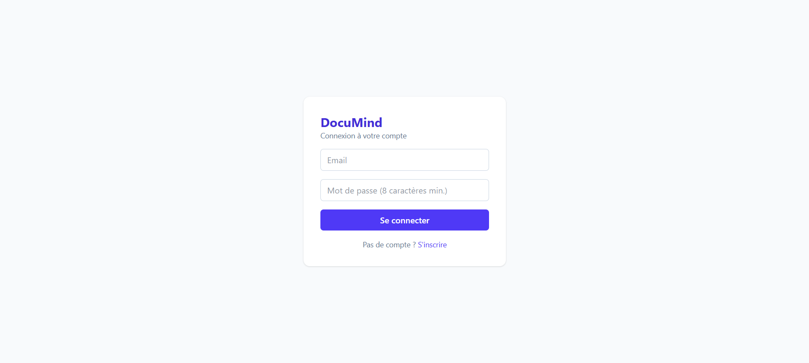 | 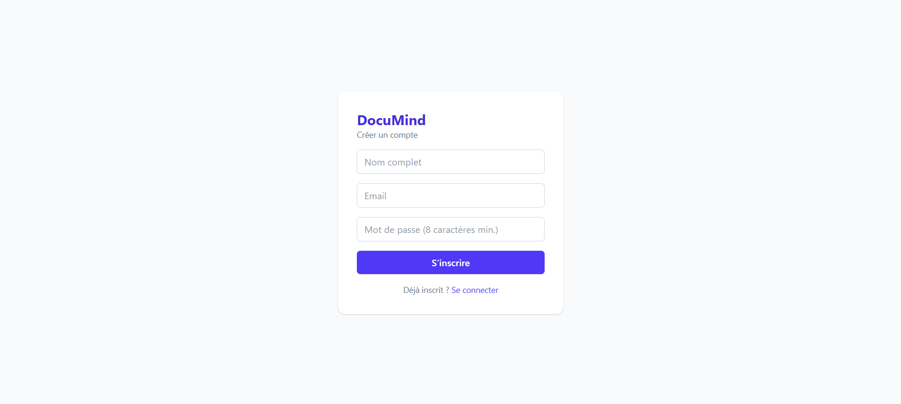 |

Un nouvel utilisateur n'a accès à aucun espace tant qu'un administrateur ne l'a pas ajouté. Il peut aussi créer son propre espace, dont il devient automatiquement administrateur.

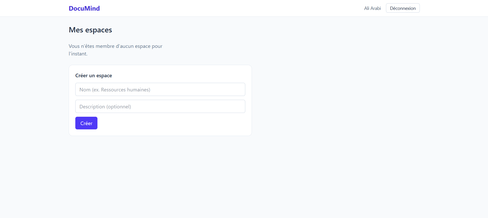

### 2. Point de vue de l'administratrice (Imane, espace RH)

Imane crée l'espace **Ressources Humaines**, y dépose un cours de GRH en PDF (13 pages, indexé automatiquement), puis invite ses collègues en choisissant leur rôle.

| Ses espaces | Documents (ajout et suppression) |
|---|---|
| 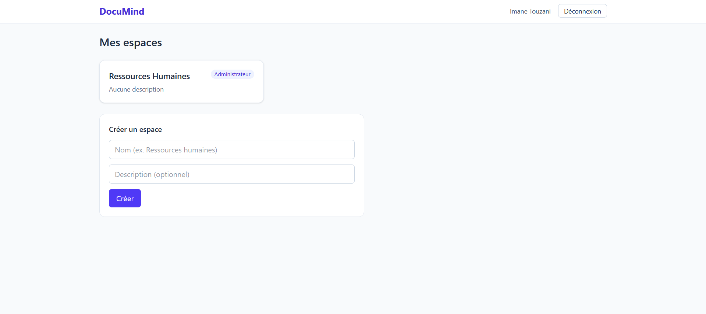 | 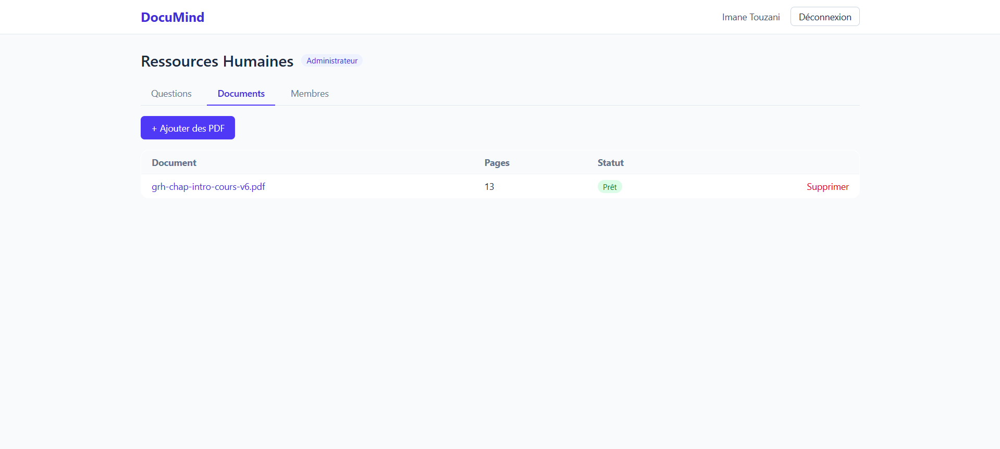 |

En tant qu'administratrice, elle peut changer le rôle de chaque membre ou le retirer de l'espace :

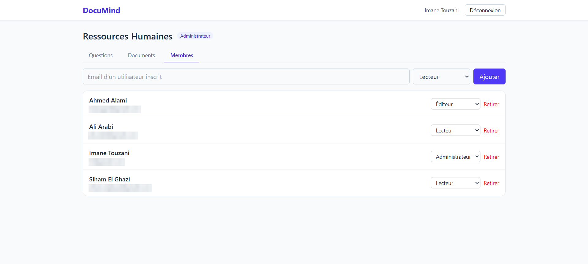

Elle pose une question : la réponse est construite à partir du cours et cite les passages utilisés ([2], [5]...).

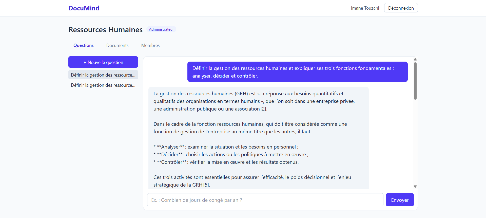

### 3. Point de vue de l'éditeur (Ahmed, espace RH)

Ahmed est **administrateur** de son propre espace "Management de projets" et **éditeur** dans l'espace RH : le rôle dépend de l'espace.

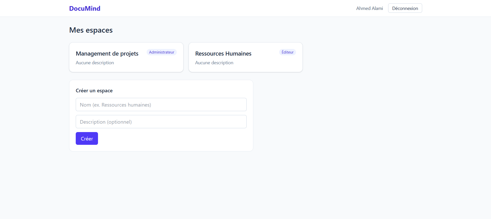

Comme éditeur, il peut ajouter et supprimer des documents, mais la liste des membres est en **lecture seule** :

| Documents (ajout autorisé) | Membres (lecture seule) |
|---|---|
| 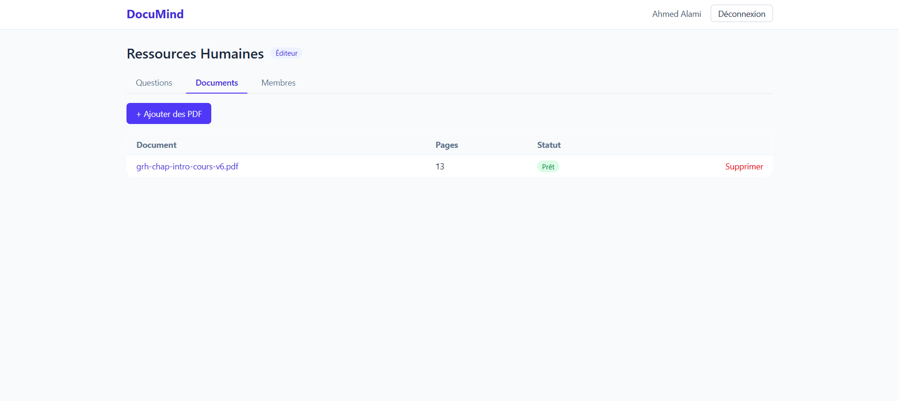 |  |

Sa question "c'est quoi le RH" reçoit une réponse sourcée, avec les pages du PDF cliquables :


### 4. Point de vue de la lectrice (Siham, espace RH)

Siham est **lectrice** dans l'espace RH et **administratrice** de son espace "Team IT".

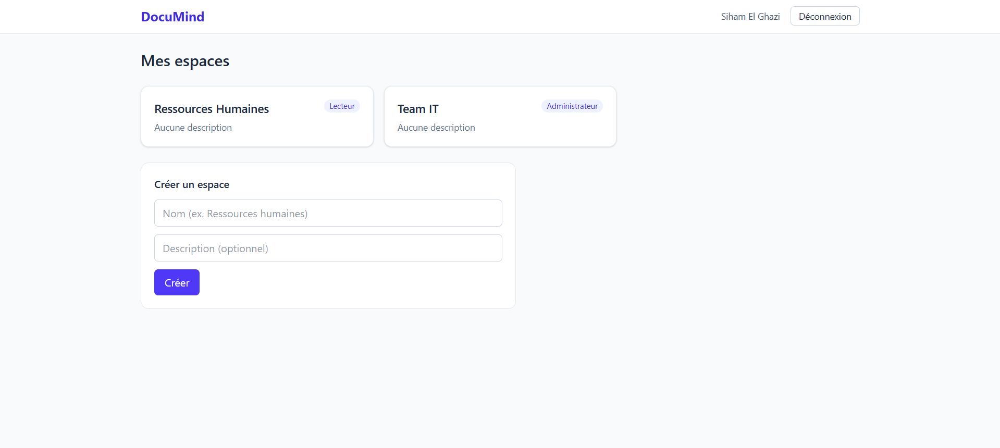

En tant que lectrice, elle consulte les documents (sans bouton d'ajout ni de suppression) et voit les membres sans pouvoir les modifier :

| Documents (consultation seule) | Membres (lecture seule) |
|---|---|
| 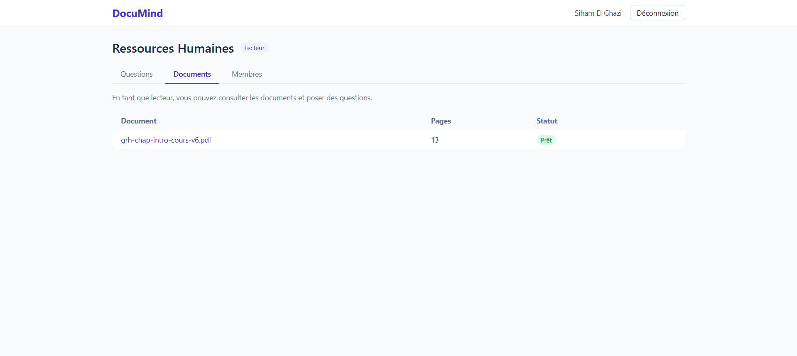 | 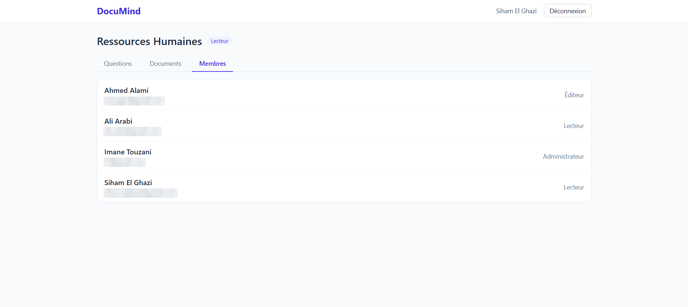 |

Elle peut quand même poser toutes ses questions :

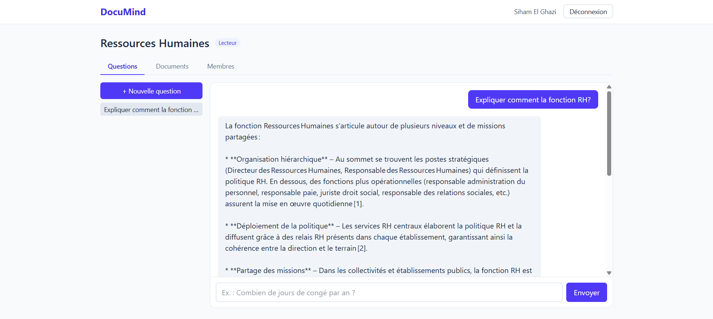

### 5. Un second espace isolé : Team IT

Dans son espace "Team IT", Siham dépose un cours sur les bases de l'informatique (28 pages). Elle en est la seule membre : les utilisateurs de l'espace RH ne voient ni cet espace ni ses documents.

| Documents | Membres |
|---|---|
| 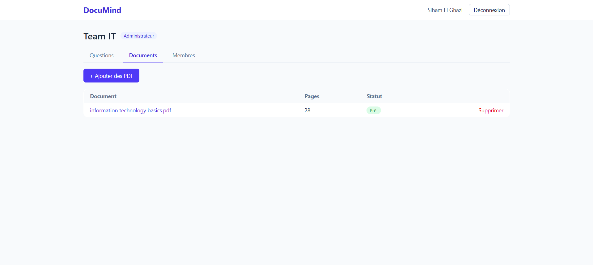 | 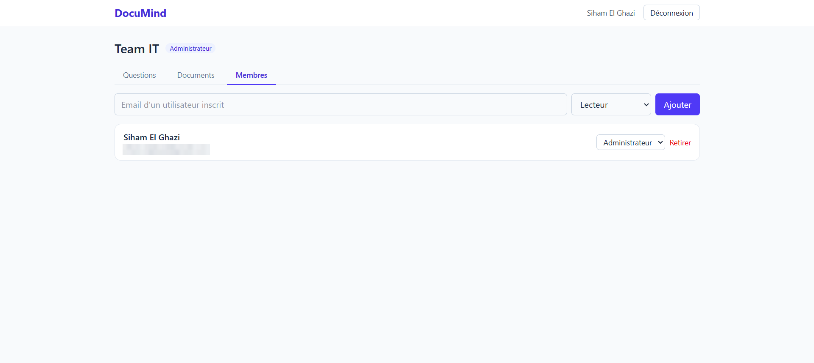 |

**Le modèle n'invente pas.** À la première question, le document ne contient pas de définition précise de l'IT, et l'assistant le dit au lieu d'inventer une réponse. À la question suivante, il répond à partir du contenu réel du document.

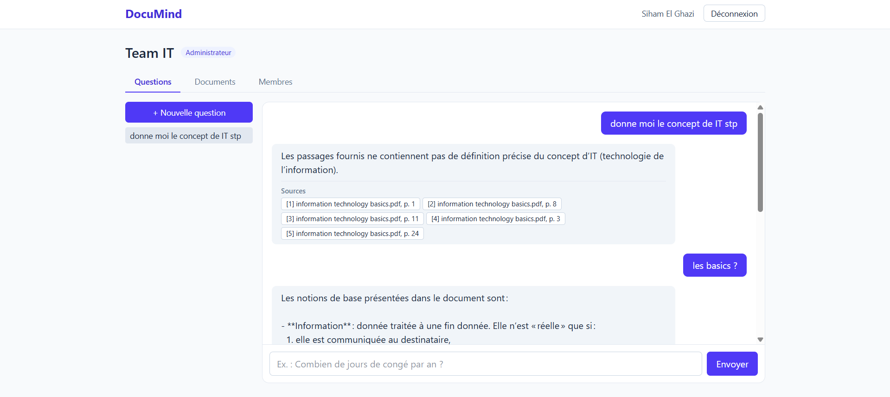

---

## Guide d'utilisation

### Premiers pas
1. Ouvre l'application et clique sur **S'inscrire** : nom complet, email, mot de passe (8 caractères minimum).
2. Sur la page **Mes espaces**, crée un espace (par exemple "Ressources humaines"). Tu en deviens l'administrateur.

### Ajouter des documents (administrateur ou éditeur)
1. Ouvre l'espace, onglet **Documents**, bouton **+ Ajouter des PDF** (plusieurs fichiers possibles).
2. Le statut passe de **En attente** à **Indexation...** puis **Prêt**. La liste se met à jour toute seule.
3. Clique sur le nom d'un document pour l'ouvrir.

> Les PDF doivent contenir du texte sélectionnable. Un PDF scanné (image) passe en statut **Erreur**, car il faudrait un OCR.

### Inviter des membres (administrateur)
1. La personne doit d'abord **créer son compte**.
2. Onglet **Membres** : saisis son email, choisis son rôle (**Lecteur**, **Éditeur** ou **Administrateur**), clique sur **Ajouter**.
3. Tu peux changer un rôle ou retirer un membre à tout moment. Un espace garde toujours au moins un administrateur.

### Poser des questions (tous les membres)
1. Onglet **Questions**, écris ta question et clique sur **Envoyer**.
2. La réponse s'affiche progressivement. Les numéros [1], [2]... renvoient aux **Sources** sous la réponse.
3. Clique sur une source pour ouvrir le PDF directement à la bonne page.
4. **+ Nouvelle question** démarre une nouvelle conversation ; les anciennes restent dans la colonne de gauche.

**Conseils pour de bonnes réponses :**
- Pose des questions précises sur le contenu des documents ("Quelles sont les trois fonctions de la GRH ?" plutôt que "Parle-moi des RH").
- Les questions peuvent être en français, en arabe ou en anglais.
- Si l'information n'est pas dans les documents de l'espace, l'assistant le dit au lieu d'inventer.

---

## Architecture

```
React + TypeScript ──(REST + JWT)──> FastAPI ──> PostgreSQL + pgvector
        ▲                               │
        └──── streaming SSE ────────────┤──> Embeddings multilingues (sentence-transformers, local)
                                        └──> LLM (Groq ou Gemini, via LangChain)
```

**Pipeline RAG :**
1. **Ingestion** (`app/rag/ingestion.py`) : PDF → texte page par page (PyMuPDF) → morceaux de ~800 caractères avec chevauchement (LangChain) → embeddings → table `chunks`
2. **Recherche** (`app/rag/retrieval.py`) : question → embedding → les 5 morceaux les plus proches (distance cosinus) dans l'espace courant uniquement
3. **Génération** (`app/rag/llm.py`) : les morceaux numérotés [1]...[5] et la question sont envoyés au LLM avec une consigne stricte (répondre uniquement à partir des passages, citer les sources), puis la réponse est renvoyée en streaming (Server-Sent Events)

## Stack technique

| Couche | Technologies |
|---|---|
| Backend | Python, FastAPI, SQLAlchemy 2, Pydantic, PyJWT, bcrypt |
| IA | LangChain, sentence-transformers (`paraphrase-multilingual-MiniLM-L12-v2`), Groq (GPT-OSS 120B) ou Google Gemini |
| Base de données | PostgreSQL + pgvector (Supabase, Neon ou Docker) |
| Frontend | React 19, TypeScript, Vite, Tailwind CSS, React Router |
| Qualité / DevOps | pytest, Ruff, GitHub Actions, Docker Compose |

---

## Installation

### Prérequis
- Python 3.12, Node.js 20 ou plus, Git
- Une base PostgreSQL avec pgvector : projet gratuit [Supabase](https://supabase.com) (utiliser l'URL du **Session pooler**) ou `docker compose up -d`
- Une clé d'API LLM gratuite : [Groq](https://console.groq.com) ou [Google AI Studio](https://aistudio.google.com)

### Backend
```bash
cd backend
python -m venv .venv
.venv\Scripts\activate          # Windows  (macOS/Linux : source .venv/bin/activate)
pip install -r requirements.txt
copy .env.example .env          # Windows  (macOS/Linux : cp .env.example .env)
# Remplir DATABASE_URL, JWT_SECRET et GROQ_API_KEY dans .env
uvicorn app.main:app --reload
```
API : http://localhost:8000 · documentation interactive (Swagger) : http://localhost:8000/docs

Au premier upload, le modèle d'embeddings (~470 Mo) est téléchargé automatiquement.

### Frontend
```bash
cd frontend
npm install
npm run dev
```
Application : http://localhost:5173

### Essayer sans clé d'API
`LLM_PROVIDER=fake` et `EMBEDDING_PROVIDER=fake` dans `.env` : l'application fonctionne avec un LLM simulé (utile pour tester l'interface).

## Tests

```bash
cd backend
pip install -r requirements-dev.txt
pytest -q   # nécessite une base PostgreSQL "documind_test"
```
Les tests utilisent des embeddings et un LLM simulés (aucune clé nécessaire). Ils couvrent l'authentification, les droits par rôle, l'isolation entre espaces, l'indexation et le chat en streaming avec citations. Ils sont lancés automatiquement par GitHub Actions à chaque push.

## API REST

| Méthode | Route | Accès |
|---|---|---|
| POST | `/api/auth/register`, `/api/auth/login` | Public |
| POST | `/api/auth/refresh` | Refresh token |
| GET | `/api/auth/me` | Connecté |
| GET / POST | `/api/workspaces` | Connecté |
| GET / DELETE | `/api/workspaces/{id}` | Membre / Admin |
| GET / POST | `/api/workspaces/{id}/members` | Membre / Admin |
| PATCH / DELETE | `/api/workspaces/{id}/members/{user_id}` | Admin |
| GET / POST | `/api/workspaces/{id}/documents` | Membre / Éditeur |
| GET | `/api/documents/{id}/file` | Membre |
| DELETE | `/api/documents/{id}` | Éditeur |
| POST | `/api/workspaces/{id}/chat` (SSE) | Membre |
| GET | `/api/workspaces/{id}/conversations` | Membre |
| GET | `/api/conversations/{id}/messages` | Propriétaire |

## Structure du projet

```
documind/
├── backend/
│   ├── app/
│   │   ├── main.py, config.py, database.py
│   │   ├── models.py          # tables SQLAlchemy
│   │   ├── schemas.py         # schémas Pydantic
│   │   ├── security.py        # bcrypt + JWT
│   │   ├── deps.py            # utilisateur connecté, contrôle des rôles
│   │   ├── routers/           # auth, workspaces, documents, chat
│   │   └── rag/               # embeddings, ingestion, retrieval, llm
│   └── tests/
├── frontend/src/
│   ├── api.ts                 # client HTTP (JWT, refresh, streaming)
│   ├── pages/                 # connexion, espaces, espace
│   └── components/            # Chat, Documents, Members
├── docs/screenshots/
├── docker-compose.yml
└── .github/workflows/ci.yml
```

## Pistes d'amélioration

- Affichage Markdown des réponses (gras, listes)
- Recherche hybride (pgvector + recherche plein texte PostgreSQL) et reranking
- Évaluation automatique de la qualité des réponses avec RAGAS
- OCR pour les PDF scannés
- Déploiement en ligne (Render pour l'API, Vercel pour le frontend)

## Sécurité et données

- **Aucun secret dans le dépôt** : l'URL de la base, la clé JWT et les clés d'API se trouvent uniquement dans `backend/.env`, ignoré par Git. Le fichier `.env.example` ne contient que des valeurs d'exemple.
- **Aucun document dans le dépôt** : les PDF déposés dans l'application sont stockés dans `backend/uploads/`, également ignoré par Git. Les documents utilisés pour la démo ne sont pas publiés.
- Mots de passe hachés avec **bcrypt**, tokens JWT signés et à durée limitée, contrôle d'accès par rôle sur chaque route, noms de fichiers d'upload aléatoires, vérification du type et de la taille des PDF.
- En production : utiliser une clé `JWT_SECRET` longue et aléatoire, activer HTTPS et restreindre `FRONTEND_ORIGIN` au domaine du frontend.

## Licence

Ce projet est distribué sous licence [MIT](LICENSE).

## Auteure

**Siham El Ghazi** · [GitHub](https://github.com/SihamEl23) · [LinkedIn](https://www.linkedin.com/in/siham-el-ghazi-34a365270/)
